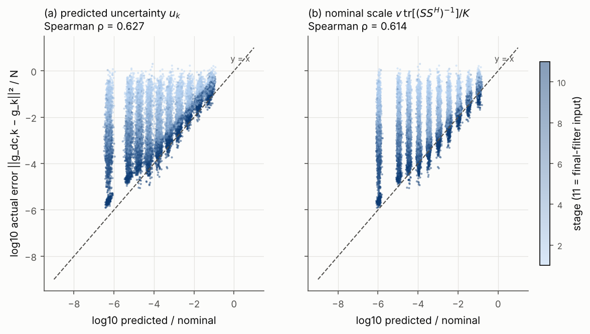
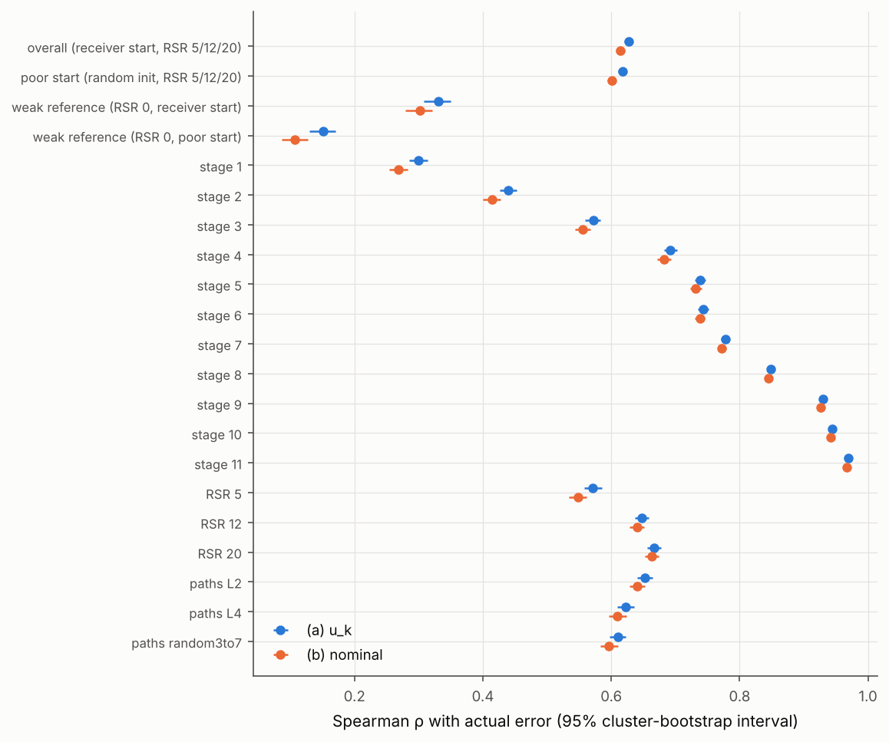
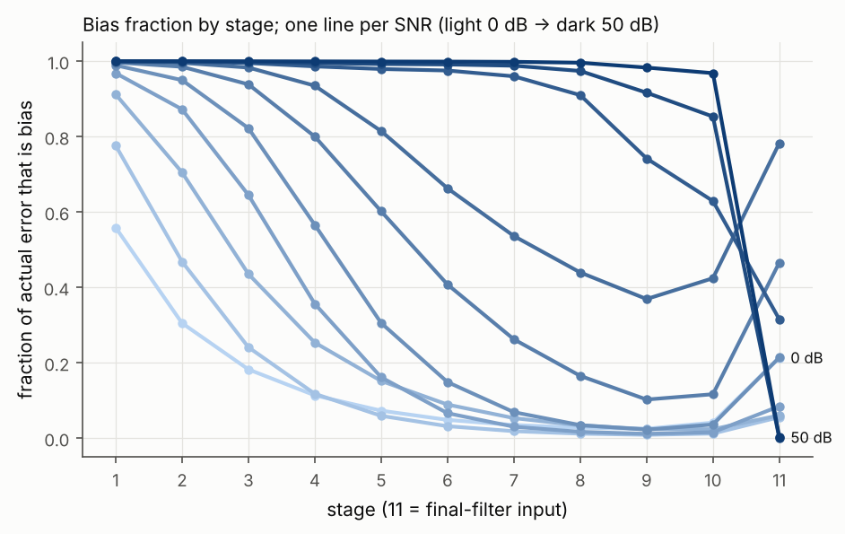

# Uncertainty-scaled Hankel filter: study report

**Status: stopped at Gate 1 (failed).** Phases 2–4 have not been run. No model was
trained, no setting was selected and no test draws were generated. The study waits
for a decision on how to proceed (Section 5).

## 1. What was tested

The question was whether the EM phase posterior gives the Hankel filter a better,
data-dependent scale than the existing noise scales. The posterior variance is
`Var = Z²(1 − R(κ)²)`; it is propagated through the M-step to
`u_k = mean_n Re[Cov(g_n)]_kk`. The existing noise scales are the controller's
feature f5 numerator `v tr[(SSᴴ)⁻¹]/K` and the final filter's
`v[(SSᴴ)⁻¹]_kk`. Full derivation: [DERIVATION.md](DERIVATION.md).

## 2. Code located and checked against the stated formulas (Phase 0)

| Component | Location | Matches the description? |
| --- | --- | --- |
| Exact Rician EM field `Q = Z R(κ) M/|M|`, small-κ series | `sahure/math.py: posterior_field`; `tcom_pilot_em_20261018/continuation.py: posterior` | Yes |
| M-step `(Q − B) Sᴴ (SSᴴ)⁻¹`, relaxed `G + γ_t (G_EM − G)`, `γ_t = 2σ(θ_t)` | `sahure/model.py`; `tcom_runtime_repair_20261020/native.py` | Yes |
| Hankel lift (17×16), `σ → σ³/(σ²+τ²)`, β mixing, antidiagonal averaging | `sahure/math.py: hankel, smooth_shrink, unhankel` | Yes. τ is relative to `s_H = sqrt(‖H‖²_F / 16)` |
| 8-16-2 controller (178 parameters), features f1–f5 + `P/2K`, `log 16`, `t/T` | `sahure/model.py` | Yes. With 10 step parameters the core has 188 |
| f5 = `log(1 + v tr[(SSᴴ)⁻¹] / (K p̂_k))` | same | Yes |
| Label-free training, 30 fit / 9 held-out pilots, 16,384 / 2,048, 20 epochs, batch 32, Adam 1e-3 | `tcom_pilot_em_20261018/training.py`, `results/.../training_protocol.json` | Yes. Training SNRs were −10 to 20 dB |
| Final filter `τ_k = c sqrt(2v Re[(SSᴴ)⁻¹]_kk max(m,q))`, `c ∈ {0, 2, 4}` | `tcom_incumbent_guard_20261019/shrink.py`; policy `results/tcom_filter_continuation_20261019/policy.json` | Yes. `c = 2` or `4` (β = 1) only at RSR 12/20 dB above 30 dB. RSR 5 has no final filter |
| High-SNR lookup table | `results/tcom_hybrid_sensitivity_20261020/protocol.json` (`proposal_policy`) | It has two parts: extra EM steps (0/10/20/40) per RSR/SNR, and the adaptive→global schedule switch above 30 dB |
| Reliability fallback | `tcom_reliability_20261021/inference.py` | Only RSR 5 above 30 dB. Not part of the filter path |

### Correction to the expected high-κ result

The high-κ limit holds: `κ(1 − R²) = 1 + 1/(8κ²) + …`, so `Var → Zv/(2|M|) → v/2`.
But for the **same `c`**, `τ_unc` does not reduce to the existing rule. It reduces
to that rule divided by √2:

    τ_unc(c) → c sqrt(v[A⁻¹]_kk max(m,q)) = τ_noise(c)/√2.

The unit test checks this corrected relation on simulated 50 and 60 dB worlds,
with `M` taken from a receiver-observable estimate. The ratio is within 3% of 1/√2;
measured values are in `results/phase0/high_snr_ratio.json`, from 0.7071 to
0.7110 at 50–60 dB. The existing rule's `2v[A⁻¹]_kk` is four times the phase-only
posterior variance. A consequence for Phase 2: the stored `c_noise = 4`
corresponds to `c_unc ≈ 5.66`, outside the prescribed grid `{0.5, 1, 2, 3, 4}`.

`u_k` is also nearly a constant multiple of the noise scale. With the receiver's
estimate, `u_k/((v/2)[A⁻¹]_kk)` is within 8% of 1 at 0 dB and RSR 5, within 0.3%
from 20 dB up, and within 0.03% at 30 dB and above. The reference `B` dominates
`M`, so `κ = 2Z|M|/v` stays large whatever the error in the channel estimate.

## 3. Phase 1: calibration

Setup (pre-registered in [configs/phase1.json](configs/phase1.json)):

- Frozen receiver, seeds 9101–9103.
- Fresh blocks, 128 channels per cell. SNR {0, 5, 10, 15, 20, 25, 30, 35, 40, 50} dB,
  RSR {5, 12, 20} dB, paths {2, 4, random 3–7}.
- Weak-reference cells at RSR 0 dB.
- Each cell also run from a random start.
- Stages 1–10 are the routed learned stages; stage 11 is the final-filter input
  after the EM tail.
- 2.28 M receiver-start records and 2.28 M poor-start records.

The instrumented stage loop reproduces the frozen starts and the frozen receiver's
filtered output with a maximum absolute difference of exactly 0 in all 120 cells.

### Gate 1 verdict: **FAIL**

| Criterion (pre-registered) | Result |
| --- | --- |
| ρ_a − ρ_b ≥ 0.05 overall, and the 95% CI excludes 0 | **+0.013** [+0.012, +0.013]: positive but far below the margin. **Fail** |
| ρ_a ≥ ρ_b − 0.02 in every major group | No group worse. **Pass** |

Note that I chose the 0.05 margin to make "clearly better" testable, and I wrote
it down before seeing any results. The actual gain is about a quarter of it.

### Rank correlation with the actual error entering the filter

Spearman ρ; intervals are a 1,000-sample cluster bootstrap over channels. "a/c" and
"b/c" are median ratios of predicted (or nominal) to actual squared error.

| Group | ρ_a (u_k) | ρ_b (nominal) | ρ_a − ρ_b [95% CI] | a/c | b/c |
| --- | --- | --- | --- | --- | --- |
| overall (receiver start, RSR 5/12/20) | 0.627 | 0.614 | +0.013 [+0.012, +0.013] | 0.198 | 0.371 |
| poor start (random init, RSR 5/12/20) | 0.617 | 0.601 | +0.017 [+0.016, +0.017] | 0.196 | 0.367 |
| weak reference (RSR 0, receiver start) | 0.330 | 0.302 | +0.028 [+0.027, +0.030] | 0.0146 | 0.0263 |
| weak reference (RSR 0, poor start) | 0.151 | 0.107 | +0.043 [+0.041, +0.045] | 0.00308 | 0.00488 |
| stage 1 | 0.300 | 0.269 | +0.031 [+0.030, +0.032] | 0.00242 | 0.0045 |
| stage 5 | 0.739 | 0.732 | +0.007 [+0.007, +0.008] | 0.202 | 0.381 |
| stage 10 | 0.945 | 0.941 | +0.003 [+0.003, +0.004] | 0.328 | 0.635 |
| stage 11 (final-filter input) | 0.969 | 0.967 | +0.003 [+0.003, +0.003] | 0.468 | 0.904 |
| RSR 5 | 0.572 | 0.548 | +0.024 [+0.023, +0.025] | 0.16 | 0.287 |
| RSR 12 | 0.648 | 0.640 | +0.007 [+0.007, +0.008] | 0.212 | 0.403 |
| RSR 20 | 0.667 | 0.663 | +0.004 [+0.003, +0.005] | 0.21 | 0.405 |
| paths L2 | 0.652 | 0.641 | +0.012 [+0.011, +0.013] | 0.225 | 0.426 |
| paths L4 | 0.623 | 0.610 | +0.013 [+0.012, +0.013] | 0.19 | 0.355 |
| paths random 3–7 | 0.610 | 0.597 | +0.013 [+0.013, +0.014] | 0.177 | 0.33 |
| SNR 0 | 0.551 | 0.228 | +0.323 [+0.298, +0.346] | 0.304 | 0.56 |
| SNR 10 | 0.440 | 0.191 | +0.249 [+0.234, +0.265] | 0.268 | 0.527 |
| SNR 20 | 0.330 | 0.117 | +0.213 [+0.199, +0.227] | 0.245 | 0.481 |
| SNR 30 | 0.225 | 0.045 | +0.180 [+0.166, +0.195] | 0.141 | 0.281 |
| SNR 40 | 0.154 | −0.002 | +0.155 [+0.140, +0.170] | 0.00373 | 0.00748 |
| SNR 50 | 0.133 | −0.011 | +0.144 [+0.131, +0.157] | 0.000412 | 0.000826 |

All stages and SNR levels are in `results/phase1/summary.json`; per-cell values are
under `per_cell`.

### Where it fails, and why

1. **Pooled, `u_k` and the nominal scale rank the error almost identically.**
   Both are dominated by the same noise level and stage ordering.

2. **The within-SNR advantage is not from the posterior where the lookup table acts.**
   Within an SNR level, `u_k` looks much better than f5 (+0.14 to +0.32). Above
   20 dB, the region the lookup table covers, all of that comes from using the
   per-user diagonal `[(SSᴴ)⁻¹]_kk` instead of the trace average. The existing
   final filter already uses that diagonal. Against the existing filter's own
   scale `v[(SSᴴ)⁻¹]_kk`, `u_k` is rank-identical to three decimals at every
   SNR from 25 to 50 dB, at stages 10 and 11 (`vs_existing_per_user_scale` in
   the summary). So `u_k` cannot carry information the table lacks.

3. **The posterior adds a little only at or below 20 dB.** There, pooled over
   reference strengths, `u_k` beats `v[(SSᴴ)⁻¹]_kk` by +0.09 to +0.15. A weaker
   reference lowers κ and raises `u_k`, as the error does. The learned controller
   (f5) runs this region and no lookup table operates there. Over the whole grid
   the gain is +0.010 (receiver start).

4. **Error entering the filter is mostly bias, which `u_k` cannot see.** `u_k`
   describes one EM step's spread with the current iterate held fixed.
   - The fraction of actual error that is bias falls from 0.92 at stage 1 to 0.31
     at stage 10, averaged over cells.
   - At 30 dB it is 0.42 at stage 10 and 0.78 at the final-filter input.
   - At 35–50 dB it stays above 0.6 through stage 10. At the final-filter input
     after the 40-step EM tail it drops to about 0.
   - Correspondingly, `u_k` underestimates the actual error: median ratio 0.20,
     geometric mean 0.044, and down to 4e-4 at 50 dB.

5. **Poor starts and weak references do not change the picture.** The gains there
   are +0.017, +0.028 and +0.043. These are larger than overall but still small.
   Weak-reference ranking is poor for both measures (ρ ≤ 0.33).

In this figure, stages 1–10 are the relaxed EM output before that stage's Hankel
filter. At or below 20 dB, stage 11 is the receiver output after the stage-10
filter, so the small rise there is the shrinkage bias.

## 4. What this means for the planned phases

- **Phase 2 (replace the lookup table with a single global-c τ_unc).** Above 20 dB,
  `τ_unc = τ_noise/√2` to within 0.3%. The arm is therefore the existing noise rule
  with one fixed `c` instead of the table's per-RSR/SNR `c ∈ {0, 2, 4}`. That can
  be tested, but the result would be about removing the table, not about the
  posterior. The c-grid also needs extending (Section 2).
- **Phase 3, Arm B (f5 → `log(1 + u_k/p̂_k)`).** This is the only arm aimed at the
  region where `u_k` carries extra information (≤20 dB, weaker reference). The
  effect there is modest.
- **Arms C/D** inherit the Phase 2 limitation above 20 dB.

## 5. Decision needed

Per the study rules, I have stopped here.

## Files

- `uncertainty.py`, `stages.py`, `phase1_calibration.py`, `phase1_analysis.py`, `test_uncertainty.py`
- `configs/phase1.json`: pre-registration, seeds and gate criteria
- `results/phase0/high_snr_ratio.json`, `results/phase1/{records,bias}.npz`,
  `results/phase1/summary.json`, `results/phase1/run_manifest.json`
  (SHA-256 of all sources, checkpoints and the policy; environment), `results/phase1/run.log`
- `figures/phase1_*.png`
