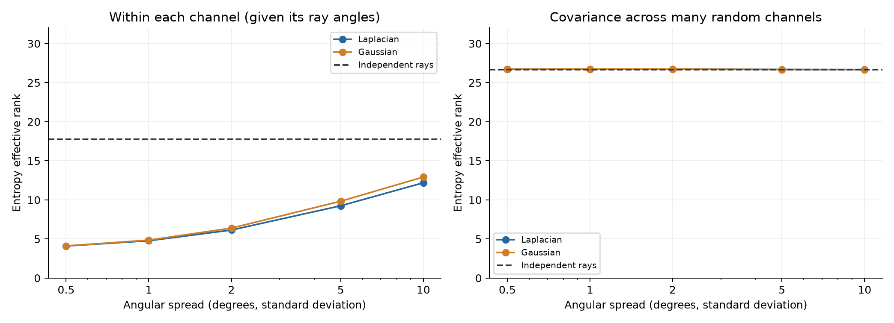
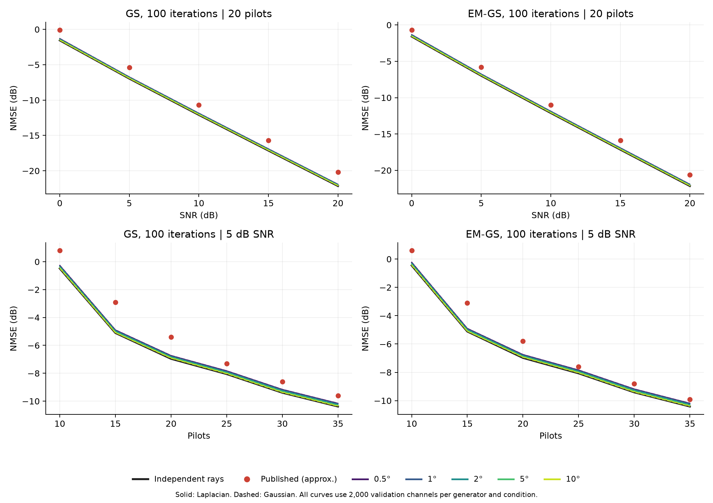
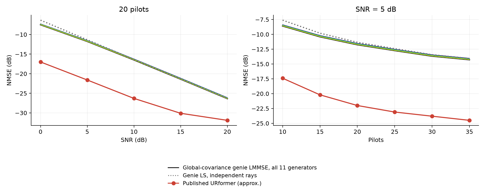

# URformer cluster audit

**Result: none of the ten clustered generators passes the requested LMMSE screen. Neural training was therefore not triggered.** Clustering clearly makes each individual channel simpler, but the global covariance does not learn where the clusters are in a new channel. This result does not rule out gains from a nonlinear learned estimator.

The audit evaluated eleven generators: independent rays, five Laplacian spreads and five Gaussian spreads. Each used a separate covariance estimate from 20,000 MIMO draws and 2,000 validation draws. The selected negative case (Gaussian 10°) and the independent-ray control were then checked on 2,000 new confirmation draws. The original `reproduction_ensemble` noise definition was retained.

11 of the 11 generators meet the earlier classical-curve tolerance. None of the ten clustered generators meets the combined classical and LMMSE target requirements.

## Verdicts

| Claim | Verdict | Reason |
| --- | --- | --- |
| Small spreads create simpler channels | Confirmed | The effective dimension within each channel falls sharply. |
| The independent-ray channel is spatially white and leaves no prior to learn | Rejected | Uniform physical angles produce correlated antenna responses, even with independent rays. |
| Clustered rays make global-covariance genie LMMSE reach the requested published targets | Rejected for the tested settings | No spread passes all target values; complete per-point gaps are below. |
| Clustering explains the published URformer gain | Inconclusive | The requested global LMMSE screen does not test a nonlinear, per-channel cluster estimator. |

## What was held fixed and what changed

There are 32 antennas, 4 users, 4 clusters per user and 10 rays per cluster. Cluster centres are drawn independently for every channel and user from uniform angles between −90° and 90°. Each offset has the requested standard deviation; Laplacian scale is spread/sqrt(2). The Gaussian standard deviation is the spread itself. Angles are reflected into the allowed interval using arcsin(sin(angle)). This reflection preserves the steering response. It also preserves the uniform marginal angle distribution for symmetric offsets.

Path gains remain independent CN(0,1), with channel scaling sqrt(32/40). Expected power per channel entry remains 32; individual channels are not forced to a fixed norm. Pilots, reference power, noise samples and CN(0,1) starting estimates are paired across generators. Noise power uses the same expected signal power as the earlier validated audit. Both classical algorithms run 100 iterations.

All covariance estimates use a separate seed stream: 20,000 independent channel matrices, each with four identically distributed users. The common spatial covariance is estimated by pooling their 80,000 user vectors. Separate per-user estimates are also saved. The population mean is known to be zero; no validation or confirmation labels enter the covariance estimate.

The genie observes the full complex field, so its phase is known. LS uses the pilot pseudoinverse. LMMSE uses the estimated population covariance and the full pilot Gram matrix, including correlations between user estimates. It does not receive the current channel’s cluster centres or ray angles. The implementation agrees with a separate full-matrix LMMSE calculation; details are in preflight_checks.json.

LMMSE here means a linear estimate based on second moments. It is not the exact Bayesian posterior mean for the clustered-channel mixture. It is designed for ordinary mean squared error and is scored using the same mean per-channel NMSE as all the other methods.

## Why clustered channels can have the same global covariance

Within one channel, nearby rays point in similar directions, so a few spatial patterns carry most of its energy. But the cluster centres move from one channel to the next. Averaging over all their positions restores a broad global covariance. Independent zero-mean path gains remove cross-ray terms from that covariance.

For this uniform physical-angle distribution and half-wavelength spacing, the population covariance is R[m,n] = 32 J0(pi(m−n)). It is the same for every tested spread under the stated reflection rule. This follows from the angular integral and [Bessel’s integral representation](https://dlmf.nist.gov/10.9.E1). The adjacent-antenna correlation is about −0.304, so this covariance is not white. Separate empirical estimates show small Monte Carlo differences, which are retained rather than rescaled away.

**A failed global-LMMSE screen is not an impossibility bound.** A nonlinear estimator could infer cluster locations from each observation and exploit structure that the global linear estimator misses. A genie supplied with the true current angles would be a different, more informed benchmark. We did not silently substitute that benchmark for the one requested.

## Spatial rank and effective rank

A single user channel is a vector and has matrix rank one by itself. To measure its spatial structure, the table reports the rank of its 32-by-40 steering matrix and the power effective rank of its conditional covariance given those ray angles. Separately, it reports the rank of the global covariance estimated from the 20,000-draw set. These quantities do not depend on SNR or pilot count.

Numerical steering rank uses max(32,40) times machine epsilon times its largest singular value. Effective rank is exp(−sum p log p), where p contains normalized covariance eigenvalues. Participation rank, 1/sum(p²), is also reported. Small numerical singular values can count toward rank while contributing almost no energy; effective rank is more useful for that distinction.

| Generator | Conditional numerical rank, mean | Conditional entropy rank, mean | Conditional participation rank, mean | Global numerical rank | Global entropy rank | Mean entry power, covariance set |
| --- | --- | --- | --- | --- | --- | --- |
| Independent rays | 31.981 | 17.732 | 14.053 | 32 | 26.683 | 32.015 |
| Laplacian 0.5° | 25.107 | 4.094 | 3.770 | 32 | 26.714 | 31.916 |
| Laplacian 1° | 26.652 | 4.768 | 4.173 | 32 | 26.727 | 31.942 |
| Laplacian 2° | 27.977 | 6.138 | 5.105 | 32 | 26.722 | 31.948 |
| Laplacian 5° | 29.290 | 9.244 | 7.371 | 32 | 26.689 | 31.973 |
| Laplacian 10° | 30.108 | 12.185 | 9.627 | 32 | 26.678 | 31.992 |
| Gaussian 0.5° | 25.431 | 4.111 | 3.777 | 32 | 26.715 | 31.915 |
| Gaussian 1° | 26.966 | 4.850 | 4.240 | 32 | 26.729 | 31.939 |
| Gaussian 2° | 28.227 | 6.385 | 5.357 | 32 | 26.728 | 31.949 |
| Gaussian 5° | 29.453 | 9.826 | 7.937 | 32 | 26.677 | 31.980 |
| Gaussian 10° | 30.224 | 12.921 | 10.299 | 32 | 26.660 | 31.989 |

Full rank counts, 5th/95th percentiles, per-channel values and the actual 32-by-4 channel matrix ranks are saved in structure/ and summary.json. Global covariance matrices and their spectra are saved in covariance/.

## Validation screening and selection

The classical match tolerance is unchanged: joint curve RMSE at most 1.5 dB and maximum absolute error at most 3 dB, across both methods and both published figures. The requested LMMSE gate requires reaching or beating every target: Figure 3 at 5 and 20 dB, and all six Figure 4 pilot counts. The stricter Figure 4 reading at P = 20 is retained separately. The primary gate adds no digitization allowance; a ±0.2 dB reading sensitivity is also recorded.

| Generator | Classical RMSE (dB) | Classical max error (dB) | Classical pass | LMMSE at 5 dB, P20 | LMMSE at 20 dB, P20 | Worst LMMSE target gap (dB) | Both pass |
| --- | --- | --- | --- | --- | --- | --- | --- |
| Independent rays | 1.313 | 2.209 | True | -11.745 | -26.348 | 10.370 | False |
| Laplacian 0.5° | 1.100 | 1.993 | True | -11.528 | -26.114 | 10.585 | False |
| Laplacian 1° | 1.129 | 2.022 | True | -11.559 | -26.149 | 10.552 | False |
| Laplacian 2° | 1.166 | 2.058 | True | -11.593 | -26.187 | 10.517 | False |
| Laplacian 5° | 1.227 | 2.130 | True | -11.657 | -26.257 | 10.456 | False |
| Laplacian 10° | 1.262 | 2.179 | True | -11.695 | -26.300 | 10.417 | False |
| Gaussian 0.5° | 1.098 | 1.992 | True | -11.526 | -26.112 | 10.587 | False |
| Gaussian 1° | 1.135 | 2.031 | True | -11.562 | -26.154 | 10.548 | False |
| Gaussian 2° | 1.173 | 2.064 | True | -11.600 | -26.195 | 10.510 | False |
| Gaussian 5° | 1.227 | 2.135 | True | -11.664 | -26.264 | 10.450 | False |
| Gaussian 10° | 1.280 | 2.187 | True | -11.713 | -26.317 | 10.400 | False |

Positive target gaps mean the genie LMMSE error is worse than the published URformer value. Lower NMSE is better. The gate is applied to the mean of per-channel linear errors, converted to dB afterward. The published values are approximate figure readings inherited unchanged from the SNR audit.

**Published Figure 3 reference, 20 pilots (approximate NMSE in dB)**

| SNR (dB) | GS100 | EM-GS100 | URformer |
| --- | --- | --- | --- |
| 0 | -0.1 | -0.7 | -17.0 |
| 5 | -5.4 | -5.8 | -21.6 |
| 10 | -10.7 | -11.0 | -26.3 |
| 15 | -15.7 | -15.9 | -30.1 |
| 20 | -20.2 | -20.6 | -31.9 |

**Published Figure 4 reference, 5 dB SNR (approximate NMSE in dB)**

| Pilots | GS100 | EM-GS100 | URformer |
| --- | --- | --- | --- |
| 10 | 0.8 | 0.6 | -17.4 |
| 15 | -2.9 | -3.1 | -20.2 |
| 20 | -5.4 | -5.8 | -22.0 |
| 25 | -7.3 | -7.6 | -23.1 |
| 30 | -8.6 | -8.8 | -23.8 |
| 35 | -9.6 | -9.9 | -24.5 |

No clustered candidate qualified. The prespecified fallback selected **Gaussian 10°** solely as the closest nonpassing case among classical matches. Its worst LMMSE target gap was 10.400 dB on validation. This was a negative confirmation, not a declaration of success. The choice was written to validation_selection.json before generating the confirmation observations. No candidate was reselected from confirmation results.

## Independent confirmation

| Generator | Classical RMSE (dB) | Classical max error (dB) | Classical pass | Worst LMMSE target gap (dB) | Both pass |
| --- | --- | --- | --- | --- | --- |
| Gaussian 10° | 1.262 | 2.154 | True | 10.405 | False |
| Independent rays | 1.316 | 2.210 | True | 10.371 | False |

| Generator | Conditional numerical rank, mean | Conditional entropy rank, mean | Entry power, mean |
| --- | --- | --- | --- |
| Gaussian 10° | 30.243 | 12.892 | 31.951 |
| Independent rays | 31.986 | 17.702 | 31.989 |

**Gaussian 10° — confirmation NMSE (dB)**

| Pilots | SNR (dB) | GS100 | EM-GS100 | Genie LS | Genie LMMSE |
| --- | --- | --- | --- | --- | --- |
| 10 | 5 | -0.4066 | -0.3743 | -7.5604 | -8.5364 |
| 15 | 5 | -5.0539 | -5.0616 | -9.7743 | -10.3781 |
| 20 | 0 | -1.5085 | -1.5341 | -6.2962 | -7.4595 |
| 20 | 5 | -6.9137 | -6.9310 | -11.2962 | -11.7116 |
| 20 | 10 | -12.0423 | -12.0479 | -16.2962 | -16.4341 |
| 20 | 15 | -17.0842 | -17.0856 | -21.2962 | -21.3407 |
| 20 | 20 | -22.0962 | -22.0966 | -26.2962 | -26.3105 |
| 25 | 5 | -8.0182 | -8.0299 | -12.3651 | -12.6948 |
| 30 | 5 | -9.3318 | -9.3472 | -13.3756 | -13.6261 |
| 35 | 5 | -10.3290 | -10.3576 | -14.0113 | -14.2298 |

**Independent rays — confirmation NMSE (dB)**

| Pilots | SNR (dB) | GS100 | EM-GS100 | Genie LS | Genie LMMSE |
| --- | --- | --- | --- | --- | --- |
| 10 | 5 | -0.4747 | -0.4342 | -7.6004 | -8.5859 |
| 15 | 5 | -5.1103 | -5.1144 | -9.8144 | -10.4244 |
| 20 | 0 | -1.5588 | -1.5785 | -6.3378 | -7.4984 |
| 20 | 5 | -6.9749 | -6.9885 | -11.3378 | -11.7522 |
| 20 | 10 | -12.1083 | -12.1129 | -16.3378 | -16.4752 |
| 20 | 15 | -17.1482 | -17.1493 | -21.3378 | -21.3822 |
| 20 | 20 | -22.1595 | -22.1598 | -26.3378 | -26.3520 |
| 25 | 5 | -8.0726 | -8.0803 | -12.4066 | -12.7288 |
| 30 | 5 | -9.3726 | -9.3871 | -13.4177 | -13.6598 |
| 35 | 5 | -10.3647 | -10.3928 | -14.0504 | -14.2616 |

## Full validation values

Each row below uses 2,000 channels. P = 20 / SNR = 5 dB appears once in these results and twice in the published-figure comparisons. Ranks above apply to all these rows.

**Independent rays — validation NMSE (dB)**

| Pilots | SNR (dB) | GS100 | EM-GS100 | Genie LS | Genie LMMSE |
| --- | --- | --- | --- | --- | --- |
| 10 | 5 | -0.4840 | -0.4520 | -7.6093 | -8.5843 |
| 15 | 5 | -5.1087 | -5.1152 | -9.8037 | -10.4078 |
| 20 | 0 | -1.5560 | -1.5828 | -6.3347 | -7.4892 |
| 20 | 5 | -6.9613 | -6.9779 | -11.3347 | -11.7448 |
| 20 | 10 | -12.0990 | -12.1037 | -16.3347 | -16.4695 |
| 20 | 15 | -17.1404 | -17.1419 | -21.3347 | -21.3775 |
| 20 | 20 | -22.1531 | -22.1540 | -26.3347 | -26.3480 |
| 25 | 5 | -8.0571 | -8.0694 | -12.4097 | -12.7297 |
| 30 | 5 | -9.3944 | -9.4106 | -13.4276 | -13.6703 |
| 35 | 5 | -10.3836 | -10.4132 | -14.0613 | -14.2734 |

**Laplacian 0.5° — validation NMSE (dB)**

| Pilots | SNR (dB) | GS100 | EM-GS100 | Genie LS | Genie LMMSE |
| --- | --- | --- | --- | --- | --- |
| 10 | 5 | -0.2633 | -0.2265 | -7.3740 | -8.3876 |
| 15 | 5 | -4.8933 | -4.9001 | -9.5696 | -10.1969 |
| 20 | 0 | -1.3014 | -1.3277 | -6.0999 | -7.3017 |
| 20 | 5 | -6.7319 | -6.7462 | -11.0999 | -11.5285 |
| 20 | 10 | -11.8626 | -11.8686 | -16.0999 | -16.2411 |
| 20 | 15 | -16.9035 | -16.9055 | -21.0999 | -21.1449 |
| 20 | 20 | -21.9157 | -21.9164 | -26.0999 | -26.1140 |
| 25 | 5 | -7.8271 | -7.8403 | -12.1776 | -12.5153 |
| 30 | 5 | -9.1615 | -9.1787 | -13.1934 | -13.4499 |
| 35 | 5 | -10.1576 | -10.1872 | -13.8261 | -14.0507 |

**Laplacian 1° — validation NMSE (dB)**

| Pilots | SNR (dB) | GS100 | EM-GS100 | Genie LS | Genie LMMSE |
| --- | --- | --- | --- | --- | --- |
| 10 | 5 | -0.2955 | -0.2593 | -7.4105 | -8.4148 |
| 15 | 5 | -4.9221 | -4.9311 | -9.6047 | -10.2254 |
| 20 | 0 | -1.3436 | -1.3671 | -6.1353 | -7.3259 |
| 20 | 5 | -6.7636 | -6.7791 | -11.1353 | -11.5587 |
| 20 | 10 | -11.8929 | -11.8990 | -16.1353 | -16.2744 |
| 20 | 15 | -16.9340 | -16.9360 | -21.1353 | -21.1794 |
| 20 | 20 | -21.9462 | -21.9469 | -26.1353 | -26.1490 |
| 25 | 5 | -7.8607 | -7.8704 | -12.2134 | -12.5482 |
| 30 | 5 | -9.1922 | -9.2093 | -13.2287 | -13.4837 |
| 35 | 5 | -10.1872 | -10.2168 | -13.8615 | -14.0865 |

**Laplacian 2° — validation NMSE (dB)**

| Pilots | SNR (dB) | GS100 | EM-GS100 | Genie LS | Genie LMMSE |
| --- | --- | --- | --- | --- | --- |
| 10 | 5 | -0.3283 | -0.2908 | -7.4493 | -8.4487 |
| 15 | 5 | -4.9579 | -4.9664 | -9.6436 | -10.2606 |
| 20 | 0 | -1.3889 | -1.4114 | -6.1733 | -7.3530 |
| 20 | 5 | -6.8025 | -6.8173 | -11.1733 | -11.5927 |
| 20 | 10 | -11.9365 | -11.9424 | -16.1733 | -16.3112 |
| 20 | 15 | -16.9775 | -16.9793 | -21.1733 | -21.2171 |
| 20 | 20 | -21.9902 | -21.9909 | -26.1733 | -26.1870 |
| 25 | 5 | -7.9031 | -7.9147 | -12.2515 | -12.5832 |
| 30 | 5 | -9.2326 | -9.2495 | -13.2667 | -13.5202 |
| 35 | 5 | -10.2308 | -10.2605 | -13.9003 | -14.1239 |

**Laplacian 5° — validation NMSE (dB)**

| Pilots | SNR (dB) | GS100 | EM-GS100 | Genie LS | Genie LMMSE |
| --- | --- | --- | --- | --- | --- |
| 10 | 5 | -0.4067 | -0.3693 | -7.5182 | -8.5083 |
| 15 | 5 | -5.0298 | -5.0338 | -9.7132 | -10.3225 |
| 20 | 0 | -1.4444 | -1.4724 | -6.2435 | -7.4078 |
| 20 | 5 | -6.8674 | -6.8836 | -11.2435 | -11.6571 |
| 20 | 10 | -12.0028 | -12.0075 | -16.2435 | -16.3794 |
| 20 | 15 | -17.0446 | -17.0461 | -21.2435 | -21.2867 |
| 20 | 20 | -22.0542 | -22.0548 | -26.2435 | -26.2570 |
| 25 | 5 | -7.9690 | -7.9794 | -12.3190 | -12.6443 |
| 30 | 5 | -9.3036 | -9.3196 | -13.3356 | -13.5809 |
| 35 | 5 | -10.2992 | -10.3285 | -13.9700 | -14.1834 |

**Laplacian 10° — validation NMSE (dB)**

| Pilots | SNR (dB) | GS100 | EM-GS100 | Genie LS | Genie LMMSE |
| --- | --- | --- | --- | --- | --- |
| 10 | 5 | -0.4353 | -0.3989 | -7.5615 | -8.5411 |
| 15 | 5 | -5.0792 | -5.0834 | -9.7558 | -10.3629 |
| 20 | 0 | -1.4952 | -1.5225 | -6.2869 | -7.4417 |
| 20 | 5 | -6.9009 | -6.9155 | -11.2869 | -11.6952 |
| 20 | 10 | -12.0353 | -12.0402 | -16.2869 | -16.4200 |
| 20 | 15 | -17.0757 | -17.0774 | -21.2869 | -21.3286 |
| 20 | 20 | -22.0881 | -22.0888 | -26.2869 | -26.2995 |
| 25 | 5 | -8.0050 | -8.0179 | -12.3608 | -12.6828 |
| 30 | 5 | -9.3468 | -9.3633 | -13.3776 | -13.6227 |
| 35 | 5 | -10.3382 | -10.3682 | -14.0128 | -14.2275 |

**Gaussian 0.5° — validation NMSE (dB)**

| Pilots | SNR (dB) | GS100 | EM-GS100 | Genie LS | Genie LMMSE |
| --- | --- | --- | --- | --- | --- |
| 10 | 5 | -0.2580 | -0.2209 | -7.3716 | -8.3848 |
| 15 | 5 | -4.8922 | -4.8995 | -9.5674 | -10.1943 |
| 20 | 0 | -1.2994 | -1.3262 | -6.0976 | -7.2990 |
| 20 | 5 | -6.7286 | -6.7449 | -11.0976 | -11.5259 |
| 20 | 10 | -11.8606 | -11.8662 | -16.0976 | -16.2387 |
| 20 | 15 | -16.9023 | -16.9042 | -21.0976 | -21.1425 |
| 20 | 20 | -21.9143 | -21.9150 | -26.0976 | -26.1117 |
| 25 | 5 | -7.8266 | -7.8376 | -12.1753 | -12.5130 |
| 30 | 5 | -9.1590 | -9.1760 | -13.1910 | -13.4473 |
| 35 | 5 | -10.1552 | -10.1849 | -13.8238 | -14.0483 |

**Gaussian 1° — validation NMSE (dB)**

| Pilots | SNR (dB) | GS100 | EM-GS100 | Genie LS | Genie LMMSE |
| --- | --- | --- | --- | --- | --- |
| 10 | 5 | -0.3040 | -0.2693 | -7.4147 | -8.4165 |
| 15 | 5 | -4.9310 | -4.9385 | -9.6092 | -10.2280 |
| 20 | 0 | -1.3490 | -1.3713 | -6.1401 | -7.3275 |
| 20 | 5 | -6.7676 | -6.7822 | -11.1401 | -11.5620 |
| 20 | 10 | -11.9001 | -11.9059 | -16.1401 | -16.2785 |
| 20 | 15 | -16.9405 | -16.9426 | -21.1401 | -21.1839 |
| 20 | 20 | -21.9525 | -21.9532 | -26.1401 | -26.1536 |
| 25 | 5 | -7.8680 | -7.8794 | -12.2182 | -12.5522 |
| 30 | 5 | -9.1982 | -9.2156 | -13.2332 | -13.4875 |
| 35 | 5 | -10.1927 | -10.2225 | -13.8663 | -14.0905 |

**Gaussian 2° — validation NMSE (dB)**

| Pilots | SNR (dB) | GS100 | EM-GS100 | Genie LS | Genie LMMSE |
| --- | --- | --- | --- | --- | --- |
| 10 | 5 | -0.3337 | -0.2956 | -7.4578 | -8.4565 |
| 15 | 5 | -4.9639 | -4.9722 | -9.6513 | -10.2673 |
| 20 | 0 | -1.4065 | -1.4293 | -6.1814 | -7.3589 |
| 20 | 5 | -6.8085 | -6.8224 | -11.1814 | -11.6000 |
| 20 | 10 | -11.9448 | -11.9510 | -16.1814 | -16.3191 |
| 20 | 15 | -16.9842 | -16.9863 | -21.1814 | -21.2252 |
| 20 | 20 | -21.9964 | -21.9972 | -26.1814 | -26.1951 |
| 25 | 5 | -7.9104 | -7.9225 | -12.2593 | -12.5904 |
| 30 | 5 | -9.2424 | -9.2586 | -13.2747 | -13.5273 |
| 35 | 5 | -10.2416 | -10.2711 | -13.9085 | -14.1310 |

**Gaussian 5° — validation NMSE (dB)**

| Pilots | SNR (dB) | GS100 | EM-GS100 | Genie LS | Genie LMMSE |
| --- | --- | --- | --- | --- | --- |
| 10 | 5 | -0.4079 | -0.3679 | -7.5244 | -8.5094 |
| 15 | 5 | -5.0355 | -5.0414 | -9.7192 | -10.3277 |
| 20 | 0 | -1.4529 | -1.4778 | -6.2500 | -7.4137 |
| 20 | 5 | -6.8634 | -6.8794 | -11.2500 | -11.6640 |
| 20 | 10 | -12.0008 | -12.0062 | -16.2500 | -16.3864 |
| 20 | 15 | -17.0394 | -17.0409 | -21.2500 | -21.2935 |
| 20 | 20 | -22.0466 | -22.0472 | -26.2500 | -26.2637 |
| 25 | 5 | -7.9688 | -7.9771 | -12.3251 | -12.6496 |
| 30 | 5 | -9.3100 | -9.3268 | -13.3421 | -13.5862 |
| 35 | 5 | -10.3047 | -10.3340 | -13.9765 | -14.1888 |

**Gaussian 10° — validation NMSE (dB)**

| Pilots | SNR (dB) | GS100 | EM-GS100 | Genie LS | Genie LMMSE |
| --- | --- | --- | --- | --- | --- |
| 10 | 5 | -0.4630 | -0.4310 | -7.5790 | -8.5505 |
| 15 | 5 | -5.0867 | -5.0923 | -9.7726 | -10.3764 |
| 20 | 0 | -1.5222 | -1.5489 | -6.3039 | -7.4566 |
| 20 | 5 | -6.9193 | -6.9344 | -11.3039 | -11.7126 |
| 20 | 10 | -12.0529 | -12.0579 | -16.3039 | -16.4380 |
| 20 | 15 | -17.0939 | -17.0955 | -21.3039 | -21.3464 |
| 20 | 20 | -22.1068 | -22.1073 | -26.3039 | -26.3171 |
| 25 | 5 | -8.0311 | -8.0384 | -12.3784 | -12.7002 |
| 30 | 5 | -9.3735 | -9.3905 | -13.3951 | -13.6365 |
| 35 | 5 | -10.3629 | -10.3929 | -14.0304 | -14.2405 |

## LMMSE target gaps at every requested published point

Each number is computed LMMSE NMSE minus the published URformer NMSE, in dB. Positive values fail the target.

| Generator | Fig3 5 dB | Fig3 20 dB | Fig4 P10 | Fig4 P15 | Fig4 P20 | Fig4 P25 | Fig4 P30 | Fig4 P35 |
| --- | --- | --- | --- | --- | --- | --- | --- | --- |
| Independent rays | 9.855 | 5.552 | 8.816 | 9.792 | 10.255 | 10.370 | 10.130 | 10.227 |
| Laplacian 0.5° | 10.072 | 5.786 | 9.012 | 10.003 | 10.472 | 10.585 | 10.350 | 10.449 |
| Laplacian 1° | 10.041 | 5.751 | 8.985 | 9.975 | 10.441 | 10.552 | 10.316 | 10.414 |
| Laplacian 2° | 10.007 | 5.713 | 8.951 | 9.939 | 10.407 | 10.517 | 10.280 | 10.376 |
| Laplacian 5° | 9.943 | 5.643 | 8.892 | 9.878 | 10.343 | 10.456 | 10.219 | 10.317 |
| Laplacian 10° | 9.905 | 5.600 | 8.859 | 9.837 | 10.305 | 10.417 | 10.177 | 10.273 |
| Gaussian 0.5° | 10.074 | 5.788 | 9.015 | 10.006 | 10.474 | 10.587 | 10.353 | 10.452 |
| Gaussian 1° | 10.038 | 5.746 | 8.984 | 9.972 | 10.438 | 10.548 | 10.313 | 10.410 |
| Gaussian 2° | 10.000 | 5.705 | 8.943 | 9.933 | 10.400 | 10.510 | 10.273 | 10.369 |
| Gaussian 5° | 9.936 | 5.636 | 8.891 | 9.872 | 10.336 | 10.450 | 10.214 | 10.311 |
| Gaussian 10° | 9.887 | 5.583 | 8.850 | 9.824 | 10.287 | 10.400 | 10.163 | 10.260 |

All per-point GS/EM absolute errors against published values are recorded in summary.json under validation and confirmation. The raw mean-normalized errors for every method and channel are stored in cells/.

## Calibration at P = 20, SNR = 5 dB

| Generator | Mean entry power | Realized aggregate SNR (dB) | Realized aggregate RSR (dB) | Distance of global covariance from analytic law |
| --- | --- | --- | --- | --- |
| Independent rays | 32.088 | 5.014 | 9.984 | 0.0150 |
| Laplacian 0.5° | 32.021 | 4.991 | 10.006 | 0.0180 |
| Laplacian 1° | 32.104 | 5.000 | 9.997 | 0.0179 |
| Laplacian 2° | 32.041 | 4.992 | 10.005 | 0.0178 |
| Laplacian 5° | 32.053 | 5.000 | 9.998 | 0.0168 |
| Laplacian 10° | 32.090 | 5.010 | 9.988 | 0.0166 |
| Gaussian 0.5° | 32.003 | 4.988 | 10.009 | 0.0179 |
| Gaussian 1° | 32.125 | 5.003 | 9.995 | 0.0177 |
| Gaussian 2° | 32.059 | 4.995 | 10.002 | 0.0179 |
| Gaussian 5° | 32.018 | 4.994 | 10.003 | 0.0169 |
| Gaussian 10° | 32.179 | 5.018 | 9.979 | 0.0167 |

The covariance distance is a relative Frobenius norm. Finite-sample powers fluctuate because channels are not normalized individually. All estimators receive the same known noise variance and reference.

## Task 4: conditional training

| Requested experiment | Status | Reason |
| --- | --- | --- |
| 64-sample overfit test | Not run | No spread passed the requested screen. |
| v3 retraining: 3 seeds, 20,000 samples, 50 epochs | Not run | No spread passed the requested screen. |
| v1 encoder sensitivity: FFN(LN(A))+A | Not run | The conditional training branch was not triggered. |

No new claim about URformer accuracy, v1 versus v3, or trainability follows from this audit. The smallest change needed to test the broader clustering explanation would be a benchmark that can adapt to each channel’s cluster locations, rather than screening only through one global covariance. That is a different follow-up, and has not been added here.

## Reproducibility and checks

Master seed: 2026102801. Covariance, validation and confirmation use distinct split keys 101, 201 and 301. All cases use float64/complex128. Three workers, each with one numerical thread, evaluate independent generators. The fixed pilot seed is unchanged from the earlier study.

Independent checks passed: full-matrix versus separable LMMSE, GS/EM versus the earlier PyTorch implementation, zero-spread rank, exact independent-ray formula, noise calibration, and the reflected-angle covariance identity. All 429 protected files, including the complete SNR audit, were unchanged.

Run from the repository root with the existing environment: `../../.venv-paper2/bin/python -B experiments/urformer_cluster_audit/checks.py`, then `audit.py`, `report.py` and `finalize.py` from the same directory. Completed numerical studies refuse silent reruns. Source/configuration hashes are locked before validation generation. Every covariance sample stream has a hash, and final file hashes are recorded in manifest.json.

The approximately 95% Monte Carlo intervals in summary.json describe sampling error for each mean NMSE. They are not simultaneous intervals or uncertainty in the published figure readings. Selection used validation means only. Confirmation did not fit a covariance, tune a spread or change a threshold.
