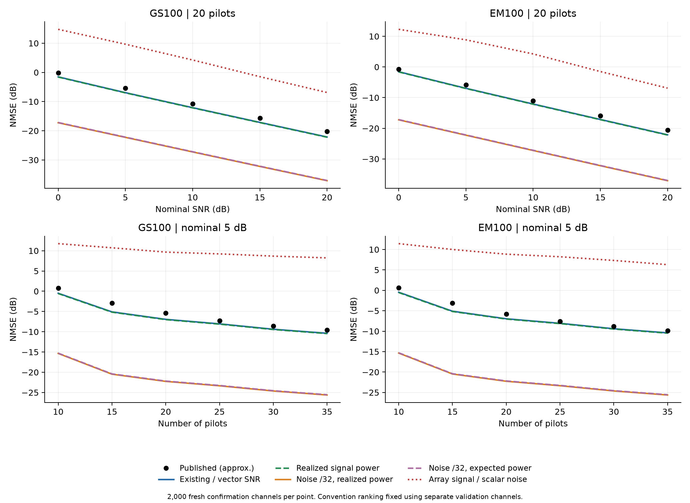
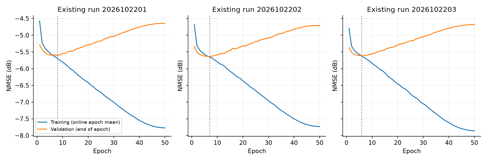

# URformer SNR audit

**Verdict: the classical curves reject a common +15.05 dB SNR shift as the explanation for the reproduction gap.** The data identify the unshifted SNR family, not the authors' exact implementation. Neural-only normalization and training causes remain unresolved.

In simple terms: if every method had received 32 times less noise, the ordinary GS and EM-GS methods would also have improved by about 15 dB. They do not show that improvement in the published figures. Our original noise setting is much closer to those figures. Changing the noise for every method would therefore make the reproduction less faithful.

This audit used 2,000 independent oracle channels, 2,000 validation channels and 2,000 separate confirmation channels. All six conventions used the same paired channels, unit noise, pilot bank and random CN(0,1) starting estimates within each split. GS and EM-GS each ran 100 iterations. Mean per-channel linear NMSE was averaged before converting to dB.

All new outputs are in this directory. Earlier studies and checkpoints were read only. No neural training was performed.

## Hypothesis verdicts

| Hypothesis | Verdict | Evidence/limit |
| --- | --- | --- |
| Shared +15.05 dB SNR shift | Rejected | Confirmation baseline RMSE: existing 1.297 dB; noise/32 16.452 dB. |
| Correct vector-power SNR creates a factor M | Rejected analytically | M cancels between total signal power and total noise power. |
| Neural pipeline used a different normalization from classical baselines | Inconclusive | Authors code or sample data needed; classical curves alone cannot settle this. |
| Input amplitude was rescaled while preserving SNR | Inconclusive | Scaling channel, reference, noise and starting estimate together can leave classical NMSE unchanged but affect neural training. |
| Training explains a further fixed 3-5 dB gap | Inconclusive | Earlier histories show training improvement with validation deterioration; neither the cause nor a universal gap reduction is established. |
| Published -21.6 dB is mathematically unreachable at our 5 dB | Inconclusive | It beats the tested genie LS estimators, but these are not universal Bayesian lower bounds. |

## Task 1: oracle references under the existing generator

| SNR (dB) | Genie complex LS | K/((P-K) SNR) | Exact fixed-pilot expectation | True-DoA projected LS |
| --- | --- | --- | --- | --- |
| 0 | -6.3532 | -6.0206 | -6.3336 | -6.3556 |
| 5 | -11.3532 | -11.0206 | -11.3336 | -11.3556 |
| 10 | -16.3532 | -16.0206 | -16.3336 | -16.3556 |
| 15 | -21.3532 | -21.0206 | -21.3336 | -21.3556 |
| 20 | -26.3532 | -26.0206 | -26.3336 | -26.3556 |

Entries are NMSE in dB. The requested theory expression assumes an ensemble of random Gaussian pilots and normalized expected channel energy. Our reproduction uses one fixed pilot matrix and mean per-channel error ratios. Its exact conditional reference is E[M sigma^2 tr((SS^H)^-1)/||H||_F^2]. The numerical and exact conditional values agree within sampling error.

With 40 independent rays per user and 32 antennas, the true steering span is almost always the entire antenna space. The tiny projection gain is therefore expected. Numerical rank uses max(M,40) times machine epsilon times the largest singular value. Rank counts across 8,000 user channels: {'29': 4, '30': 16, '31': 76, '32': 7904}.

**Reachability:** -21.6 dB at nominal 5 dB is below both tested oracle-LS errors. That makes a prior/distribution/normalization audit useful, but does not prove impossibility. Gaussian/cluster priors can improve on LS even when the steering span is full rank. The task's proposed "ceiling" is not a valid ceiling on all learned estimators.

## Task 2: explicit SNR conventions

Let q(H)=mean|HS|^2, q_bar=32||S||_F^2/P and rho=10^(SNR_dB/10). The same known reference B=sqrt(10 q_bar) is used throughout, so ensemble RSR is 10 dB. Individual realized RSR varies; the reported ratio excludes the reference from signal power.

| Argument | Noise variance sigma^2 | Meaning |
| --- | --- | --- |
| reproduction_ensemble | q_bar/rho | Actual frozen reproduction convention. |
| ours | q(H)/rho | Requested per-realization convention; differs from the frozen reproduction. |
| paper_vector | M q_bar/(M rho)=q_bar/rho | Proper vector signal/noise ratio; exactly equivalent to existing convention. |
| paper_shifted | q(H)/(32 rho) | Requested +15.05 dB hypothesis. |
| unit_channel_assumed | q_bar/(32 rho) | Expected-power analogue: noise computed as if channel entries had unit power. |
| array_signal_scalar_noise | 32 q_bar/rho | Array-summed signal divided by per-antenna noise; produces -15.05 dB, not +15.05 dB. |

Per-entry channel power is near 32 under our unit-variance path-gain assumption. That fact alone does not shift SNR: both generated signal power and the noise calibration already include it. Both signs of an inconsistent array/scalar convention were tested. None is attributed to the authors without evidence. The scalar meaning in the paper is not sufficient to establish their actual generator.

A separate question remains: multiplying the channel, reference, noise and initial estimate by the same constant preserves SNR and the classical normalized error. An independent check using a scale of 1/sqrt(32) confirmed this to numerical precision; see scaling_check.json. Neural training can still react to that change in input size. Therefore this audit rejects a shared noise/SNR shift; it does not rule out every possible channel or network-input normalization difference.

Calibration below uses the confirmation split, P = 20, nominal 5 dB. Per-case values are means of realized dB ratios; aggregate SNR/RSR are ratios of summed powers. Full distributions and every point are in summary.json.

| Convention | Mean \|H\|^2 | Mean realized SNR dB | Aggregate SNR dB | Mean realized RSR dB | Aggregate RSR dB |
| --- | --- | --- | --- | --- | --- |
| reproduction_ensemble | 32.0446 | 4.9624 | 5.0029 | 10.0417 | 9.9978 |
| ours | 32.0446 | 5.0041 | 4.9998 | 10.0417 | 9.9978 |
| paper_vector | 32.0446 | 4.9624 | 5.0029 | 10.0417 | 9.9978 |
| paper_shifted | 32.0446 | 20.0556 | 20.0513 | 10.0417 | 9.9978 |
| unit_channel_assumed | 32.0446 | 20.0139 | 20.0544 | 10.0417 | 9.9978 |
| array_signal_scalar_noise | 32.0446 | -10.0891 | -10.0486 | 10.0417 | 9.9978 |

## Task 3: classical curves and convention selection

Convention ranking used validation draws only, with a predeclared descriptive tolerance: joint RMSE ≤ 1.5 dB and maximum absolute error ≤ 3 dB across both methods and both figures. This is a coarse reproduction check, not proof of identical settings. Approximate digitization uncertainty is 0.2 dB. The P = 20 / SNR = 5 dB location has separate readings in Figures 3 and 4; all comparison rows retain their figure identity.

| Convention | Validation RMSE | Confirmation RMSE | Confirmation mean abs error | Confirmation max abs error | Validation tolerance |
| --- | --- | --- | --- | --- | --- |
| reproduction_ensemble | 1.319 | 1.297 | 1.211 | 2.195 | True |
| paper_vector | 1.319 | 1.297 | 1.211 | 2.195 | True |
| ours | 1.368 | 1.365 | 1.284 | 2.263 | True |
| array_signal_scalar_noise | 14.689 | 14.712 | 14.612 | 17.836 | False |
| unit_channel_assumed | 16.426 | 16.379 | 16.371 | 17.507 | False |
| paper_shifted | 16.478 | 16.452 | 16.444 | 17.575 | False |

Validation winner: `reproduction_ensemble`. This selection was saved before confirmation draws were evaluated. Small differences within the unshifted family do not identify the authors' exact normalization. The large shifted-curve mismatch rejects a single common +15 dB explanation.

### Published readings

fig3 (approximate values):

| SNR dB | GS | EM-GS100 | URformer |
| --- | --- | --- | --- |
| -10 | 10.4 | 8.5 | -1.1 |
| -5 | 5.2 | 4.1 | -10.7 |
| 0 | -0.1 | -0.7 | -17.0 |
| 5 | -5.4 | -5.8 | -21.6 |
| 10 | -10.7 | -11.0 | -26.3 |
| 15 | -15.7 | -15.9 | -30.1 |
| 20 | -20.2 | -20.6 | -31.9 |

fig4 (approximate values):

| Pilots | GS | EM-GS100 | URformer |
| --- | --- | --- | --- |
| 10 | 0.8 | 0.6 | -17.4 |
| 15 | -2.9 | -3.1 | -20.2 |
| 20 | -5.4 | -5.8 | -22.0 |
| 25 | -7.3 | -7.6 | -23.1 |
| 30 | -8.6 | -8.8 | -23.8 |
| 35 | -9.6 | -9.9 | -24.5 |

Figure 4 at P = 15 shows about −20.2 dB for URformer. The v1 prose claimed −25 dB; v3 corrects it to −20 dB, consistent with the plot.

### Absolute dB error at every requested point

**reproduction_ensemble, confirmation draws**

| Figure | P | SNR | Method | Computed NMSE | Published approx. | Absolute error |
| --- | --- | --- | --- | --- | --- | --- |
| fig3 | 20 | 0 | GS100 | -1.5181 | -0.1 | 1.4181 |
| fig3 | 20 | 0 | EM100 | -1.5478 | -0.7 | 0.8478 |
| fig3 | 20 | 5 | GS100 | -6.9362 | -5.4 | 1.5362 |
| fig3 | 20 | 5 | EM100 | -6.9549 | -5.8 | 1.1549 |
| fig3 | 20 | 10 | GS100 | -12.0759 | -10.7 | 1.3759 |
| fig3 | 20 | 10 | EM100 | -12.0824 | -11.0 | 1.0824 |
| fig3 | 20 | 15 | GS100 | -17.1193 | -15.7 | 1.4193 |
| fig3 | 20 | 15 | EM100 | -17.1217 | -15.9 | 1.2217 |
| fig3 | 20 | 20 | GS100 | -22.1287 | -20.2 | 1.9287 |
| fig3 | 20 | 20 | EM100 | -22.1298 | -20.6 | 1.5298 |
| fig4 | 10 | 5 | GS100 | -0.4957 | 0.8 | 1.2957 |
| fig4 | 10 | 5 | EM100 | -0.4599 | 0.6 | 1.0599 |
| fig4 | 15 | 5 | GS100 | -5.0954 | -2.9 | 2.1954 |
| fig4 | 15 | 5 | EM100 | -5.1059 | -3.1 | 2.0059 |
| fig4 | 20 | 5 | GS100 | -6.9362 | -5.4 | 1.5362 |
| fig4 | 20 | 5 | EM100 | -6.9549 | -5.8 | 1.1549 |
| fig4 | 25 | 5 | GS100 | -8.0504 | -7.3 | 0.7504 |
| fig4 | 25 | 5 | EM100 | -8.0652 | -7.6 | 0.4652 |
| fig4 | 30 | 5 | GS100 | -9.3796 | -8.6 | 0.7796 |
| fig4 | 30 | 5 | EM100 | -9.3973 | -8.8 | 0.5973 |
| fig4 | 35 | 5 | GS100 | -10.3771 | -9.6 | 0.7771 |
| fig4 | 35 | 5 | EM100 | -10.4083 | -9.9 | 0.5083 |

**ours, confirmation draws**

| Figure | P | SNR | Method | Computed NMSE | Published approx. | Absolute error |
| --- | --- | --- | --- | --- | --- | --- |
| fig3 | 20 | 0 | GS100 | -1.5934 | -0.1 | 1.4934 |
| fig3 | 20 | 0 | EM100 | -1.6214 | -0.7 | 0.9214 |
| fig3 | 20 | 5 | GS100 | -7.0098 | -5.4 | 1.6098 |
| fig3 | 20 | 5 | EM100 | -7.0288 | -5.8 | 1.2288 |
| fig3 | 20 | 10 | GS100 | -12.1502 | -10.7 | 1.4502 |
| fig3 | 20 | 10 | EM100 | -12.1573 | -11.0 | 1.1573 |
| fig3 | 20 | 15 | GS100 | -17.1941 | -15.7 | 1.4941 |
| fig3 | 20 | 15 | EM100 | -17.1965 | -15.9 | 1.2965 |
| fig3 | 20 | 20 | GS100 | -22.2040 | -20.2 | 2.0040 |
| fig3 | 20 | 20 | EM100 | -22.2052 | -20.6 | 1.6052 |
| fig4 | 10 | 5 | GS100 | -0.5678 | 0.8 | 1.3678 |
| fig4 | 10 | 5 | EM100 | -0.5359 | 0.6 | 1.1359 |
| fig4 | 15 | 5 | GS100 | -5.1628 | -2.9 | 2.2628 |
| fig4 | 15 | 5 | EM100 | -5.1733 | -3.1 | 2.0733 |
| fig4 | 20 | 5 | GS100 | -7.0098 | -5.4 | 1.6098 |
| fig4 | 20 | 5 | EM100 | -7.0288 | -5.8 | 1.2288 |
| fig4 | 25 | 5 | GS100 | -8.1242 | -7.3 | 0.8242 |
| fig4 | 25 | 5 | EM100 | -8.1377 | -7.6 | 0.5377 |
| fig4 | 30 | 5 | GS100 | -9.4507 | -8.6 | 0.8507 |
| fig4 | 30 | 5 | EM100 | -9.4690 | -8.8 | 0.6690 |
| fig4 | 35 | 5 | GS100 | -10.4470 | -9.6 | 0.8470 |
| fig4 | 35 | 5 | EM100 | -10.4792 | -9.9 | 0.5792 |

**paper_vector, confirmation draws**

| Figure | P | SNR | Method | Computed NMSE | Published approx. | Absolute error |
| --- | --- | --- | --- | --- | --- | --- |
| fig3 | 20 | 0 | GS100 | -1.5181 | -0.1 | 1.4181 |
| fig3 | 20 | 0 | EM100 | -1.5478 | -0.7 | 0.8478 |
| fig3 | 20 | 5 | GS100 | -6.9362 | -5.4 | 1.5362 |
| fig3 | 20 | 5 | EM100 | -6.9549 | -5.8 | 1.1549 |
| fig3 | 20 | 10 | GS100 | -12.0759 | -10.7 | 1.3759 |
| fig3 | 20 | 10 | EM100 | -12.0824 | -11.0 | 1.0824 |
| fig3 | 20 | 15 | GS100 | -17.1193 | -15.7 | 1.4193 |
| fig3 | 20 | 15 | EM100 | -17.1217 | -15.9 | 1.2217 |
| fig3 | 20 | 20 | GS100 | -22.1287 | -20.2 | 1.9287 |
| fig3 | 20 | 20 | EM100 | -22.1298 | -20.6 | 1.5298 |
| fig4 | 10 | 5 | GS100 | -0.4957 | 0.8 | 1.2957 |
| fig4 | 10 | 5 | EM100 | -0.4599 | 0.6 | 1.0599 |
| fig4 | 15 | 5 | GS100 | -5.0954 | -2.9 | 2.1954 |
| fig4 | 15 | 5 | EM100 | -5.1059 | -3.1 | 2.0059 |
| fig4 | 20 | 5 | GS100 | -6.9362 | -5.4 | 1.5362 |
| fig4 | 20 | 5 | EM100 | -6.9549 | -5.8 | 1.1549 |
| fig4 | 25 | 5 | GS100 | -8.0504 | -7.3 | 0.7504 |
| fig4 | 25 | 5 | EM100 | -8.0652 | -7.6 | 0.4652 |
| fig4 | 30 | 5 | GS100 | -9.3796 | -8.6 | 0.7796 |
| fig4 | 30 | 5 | EM100 | -9.3973 | -8.8 | 0.5973 |
| fig4 | 35 | 5 | GS100 | -10.3771 | -9.6 | 0.7771 |
| fig4 | 35 | 5 | EM100 | -10.4083 | -9.9 | 0.5083 |

**paper_shifted, confirmation draws**

| Figure | P | SNR | Method | Computed NMSE | Published approx. | Absolute error |
| --- | --- | --- | --- | --- | --- | --- |
| fig3 | 20 | 0 | GS100 | -17.2458 | -0.1 | 17.1458 |
| fig3 | 20 | 0 | EM100 | -17.2482 | -0.7 | 16.5482 |
| fig3 | 20 | 5 | GS100 | -22.2555 | -5.4 | 16.8555 |
| fig3 | 20 | 5 | EM100 | -22.2567 | -5.8 | 16.4567 |
| fig3 | 20 | 10 | GS100 | -27.2496 | -10.7 | 16.5496 |
| fig3 | 20 | 10 | EM100 | -27.2500 | -11.0 | 16.2500 |
| fig3 | 20 | 15 | GS100 | -32.2132 | -15.7 | 16.5132 |
| fig3 | 20 | 15 | EM100 | -32.2134 | -15.9 | 16.3134 |
| fig3 | 20 | 20 | GS100 | -37.1013 | -20.2 | 16.9013 |
| fig3 | 20 | 20 | EM100 | -37.1014 | -20.6 | 16.5014 |
| fig4 | 10 | 5 | GS100 | -15.3512 | 0.8 | 16.1512 |
| fig4 | 10 | 5 | EM100 | -15.3552 | 0.6 | 15.9552 |
| fig4 | 15 | 5 | GS100 | -20.4752 | -2.9 | 17.5752 |
| fig4 | 15 | 5 | EM100 | -20.4758 | -3.1 | 17.3758 |
| fig4 | 20 | 5 | GS100 | -22.2555 | -5.4 | 16.8555 |
| fig4 | 20 | 5 | EM100 | -22.2567 | -5.8 | 16.4567 |
| fig4 | 25 | 5 | GS100 | -23.3415 | -7.3 | 16.0415 |
| fig4 | 25 | 5 | EM100 | -23.3427 | -7.6 | 15.7427 |
| fig4 | 30 | 5 | GS100 | -24.6271 | -8.6 | 16.0271 |
| fig4 | 30 | 5 | EM100 | -24.6281 | -8.8 | 15.8281 |
| fig4 | 35 | 5 | GS100 | -25.6153 | -9.6 | 16.0153 |
| fig4 | 35 | 5 | EM100 | -25.6165 | -9.9 | 15.7165 |

**unit_channel_assumed, confirmation draws**

| Figure | P | SNR | Method | Computed NMSE | Published approx. | Absolute error |
| --- | --- | --- | --- | --- | --- | --- |
| fig3 | 20 | 0 | GS100 | -17.1711 | -0.1 | 17.0711 |
| fig3 | 20 | 0 | EM100 | -17.1734 | -0.7 | 16.4734 |
| fig3 | 20 | 5 | GS100 | -22.1802 | -5.4 | 16.7802 |
| fig3 | 20 | 5 | EM100 | -22.1813 | -5.8 | 16.3813 |
| fig3 | 20 | 10 | GS100 | -27.1740 | -10.7 | 16.4740 |
| fig3 | 20 | 10 | EM100 | -27.1745 | -11.0 | 16.1745 |
| fig3 | 20 | 15 | GS100 | -32.1382 | -15.7 | 16.4382 |
| fig3 | 20 | 15 | EM100 | -32.1385 | -15.9 | 16.2385 |
| fig3 | 20 | 20 | GS100 | -37.0282 | -20.2 | 16.8282 |
| fig3 | 20 | 20 | EM100 | -37.0284 | -20.6 | 16.4284 |
| fig4 | 10 | 5 | GS100 | -15.2852 | 0.8 | 16.0852 |
| fig4 | 10 | 5 | EM100 | -15.2888 | 0.6 | 15.8888 |
| fig4 | 15 | 5 | GS100 | -20.4068 | -2.9 | 17.5068 |
| fig4 | 15 | 5 | EM100 | -20.4075 | -3.1 | 17.3075 |
| fig4 | 20 | 5 | GS100 | -22.1802 | -5.4 | 16.7802 |
| fig4 | 20 | 5 | EM100 | -22.1813 | -5.8 | 16.3813 |
| fig4 | 25 | 5 | GS100 | -23.2677 | -7.3 | 15.9677 |
| fig4 | 25 | 5 | EM100 | -23.2687 | -7.6 | 15.6687 |
| fig4 | 30 | 5 | GS100 | -24.5549 | -8.6 | 15.9549 |
| fig4 | 30 | 5 | EM100 | -24.5558 | -8.8 | 15.7558 |
| fig4 | 35 | 5 | GS100 | -25.5435 | -9.6 | 15.9435 |
| fig4 | 35 | 5 | EM100 | -25.5446 | -9.9 | 15.6446 |

**array_signal_scalar_noise, confirmation draws**

| Figure | P | SNR | Method | Computed NMSE | Published approx. | Absolute error |
| --- | --- | --- | --- | --- | --- | --- |
| fig3 | 20 | 0 | GS100 | 14.7631 | -0.1 | 14.8631 |
| fig3 | 20 | 0 | EM100 | 12.2837 | -0.7 | 12.9837 |
| fig3 | 20 | 5 | GS100 | 9.6641 | -5.4 | 15.0641 |
| fig3 | 20 | 5 | EM100 | 8.8554 | -5.8 | 14.6554 |
| fig3 | 20 | 10 | GS100 | 4.2555 | -10.7 | 14.9555 |
| fig3 | 20 | 10 | EM100 | 4.2552 | -11.0 | 15.2552 |
| fig3 | 20 | 15 | GS100 | -1.4601 | -15.7 | 14.2399 |
| fig3 | 20 | 15 | EM100 | -1.4896 | -15.9 | 14.4104 |
| fig3 | 20 | 20 | GS100 | -6.8822 | -20.2 | 13.3178 |
| fig3 | 20 | 20 | EM100 | -6.9012 | -20.6 | 13.6988 |
| fig4 | 10 | 5 | GS100 | 11.7533 | 0.8 | 10.9533 |
| fig4 | 10 | 5 | EM100 | 11.4348 | 0.6 | 10.8348 |
| fig4 | 15 | 5 | GS100 | 10.7277 | -2.9 | 13.6277 |
| fig4 | 15 | 5 | EM100 | 10.0057 | -3.1 | 13.1057 |
| fig4 | 20 | 5 | GS100 | 9.6641 | -5.4 | 15.0641 |
| fig4 | 20 | 5 | EM100 | 8.8554 | -5.8 | 14.6554 |
| fig4 | 25 | 5 | GS100 | 9.2237 | -7.3 | 16.5237 |
| fig4 | 25 | 5 | EM100 | 8.2274 | -7.6 | 15.8274 |
| fig4 | 30 | 5 | GS100 | 8.6729 | -8.6 | 17.2729 |
| fig4 | 30 | 5 | EM100 | 7.3206 | -8.8 | 16.1206 |
| fig4 | 35 | 5 | GS100 | 8.2360 | -9.6 | 17.8360 |
| fig4 | 35 | 5 | EM100 | 6.2935 | -9.9 | 16.1935 |

## Tasks 4-5: stopping decision and training evidence

The user requested stopping when a step clearly settles the normalization question. Task 3 rejects a shared +15 dB shift. The unshifted scale already has completed three-seed, 20,000-example, 50-epoch supervised training in the earlier reproduction. Repeating it would not test a newly supported normalization correction. We therefore stopped before new neural training. This does not claim that the entire URformer reproduction gap has been solved.

| Requested task | Status | What is available |
| --- | --- | --- |
| 4: retrain under matching convention | Not rerun under stop rule | Earlier unshifted supervised runs completed; no new normalization was supported. |
| 5a: 64-sample overfit test | Not run | Still a useful follow-up; failing −30 dB alone would not uniquely prove a code bug. |
| 5b: per-SNR train/validation curves | Not run | Existing aggregate epoch curves plotted below; per-SNR epoch histories were not saved. |
| 5c: single-SNR versus mixed training | Not run | Cannot attribute the gap to mixed-SNR training yet. |
| 5d: loss variants | Not run | No test-based loss selection. |
| 5e: FilterNet/Transformer ablations and filter curve | Not run | Architecture-version and module tests remain pending. |

Earlier supervised results at 20 pilots, averaged across three seeds (no new training or evaluation):

| SNR (dB) | Final weights NMSE (dB) | Validation-selected weights NMSE (dB) | Published URformer, approximate (dB) |
| --- | --- | --- | --- |
| 5.0 | -7.1339 | -7.6556 | -21.6 |
| 20.0 | -15.1320 | -16.4019 | -31.9 |

These earlier test results are reported for context only. They did not select the normalization convention in this audit.

Existing supervised validation evidence (no new training):

| Seed | Epochs | Best epoch among saved histories | Best validation NMSE dB | Final validation NMSE dB | First training NMSE dB | Final training NMSE dB |
| --- | --- | --- | --- | --- | --- | --- |
| 2026102201 | 50 | 8 | -5.6085 | -4.6453 | -4.5706 | -7.7724 |
| 2026102202 | 50 | 7 | -5.6396 | -4.7069 | -4.6870 | -7.7338 |
| 2026102203 | 50 | 6 | -5.6142 | -4.6823 | -4.7916 | -7.8566 |

Training values are online minibatch means during an epoch; validation uses fixed weights at its end. They are not identical evaluation procedures. These histories show validation deterioration after early epochs, but do not establish a particular 3–5 dB benefit from changing the loss, or prove a bug. In this audit, no neural fitting occurred, and H entered only simulation, scoring and oracle diagnostics.

## Task 6: version audit

Sources: [v1 HTML](https://arxiv.org/html/2509.12586v1) and [v3 PDF](https://arxiv.org/pdf/2509.12586v3), with a local copy in reference/v3.pdf. The latest PDF pages 3–4 were rendered and inspected.

| Item | v1 | v3 / current code |
| --- | --- | --- |
| FFN normalization | FFN(LN(A))+A | FFN(A)+A; current code follows v3. |
| Initialization | Not specified for URformer | Random complex Gaussian, normalized variance; paper-setting code uses CN(0,1). |
| FilterNet | Small MLP | Two-layer scalar network, output in (0,1); hidden width/activation still assumptions. |
| Layer indices | Gate t; filter/Former unindexed | Stage t-1 indices explicit; prose still has g(t). Current code uses separate stage weights. |
| Training details | 20,000 samples | Adds Adam, cosine schedule over 50 epochs, batch size 32, learning rate 0.001. |
| Transduction | Constants normalized away | Explicit known G; current code divides it out. |
| Channel notation | Mentions unused large-scale beta | Drops beta sentence; tilde(h)-to-h normalization still unstated. |
| Pilot count | P = 20 in table | P = 20 in Figure 3 text. |
| Figure 4 target at 15 pilots | Prose says −25 dB | Prose corrected to −20 dB; plot about −20.2 dB. |

The SNR/RSR expressions, steering scaling, user-token layout, residual addition, NMSE objective and 100 classical iterations are unchanged. Full implementation notes are in version_audit.json. The missing FFN normalization is a real architectural difference, not evidence that either printed version was used for the published curves. Ask the authors which encoder produced the figures before treating it as the cause.

## Smallest useful next checks

Keep the current noise definition. First run the 64-sample fitting check to see whether the network can learn a tiny dataset at all. Next compare the two printed encoder versions using the same training data and a separate validation set. If both can fit the small dataset, compare training at 5 dB alone and 20 dB alone with mixed-SNR training. These tests isolate basic learning problems before a larger set of loss and module experiments. They have not been run in this audit.

## Suggested paper paragraph

We audited the normalization in our independent URformer implementation using paired classical baselines and 2,000 separate confirmation channels. The existing per-antenna power definition and a consistent vector-power definition are equivalent. Their classical-curve RMSE against approximate published readings was 1.30 dB, whereas dividing noise variance by 32 increased it to 16.45 dB. Thus a shared 15.05 dB SNR shift does not explain the reproduction gap. Unspecified channel/training details and a difference in feed-forward layer normalization between paper versions remain unresolved. We report our implementation as an independent reimplementation and do not infer superiority over the published URformer results.

## Questions for the authors

1. Could you share the data generator or one seeded batch at nominal 5 dB, including H,S,B,sigma^2 and W, and the measured powers used to calculate SNR/RSR? Is exactly the same generator used for neural and classical results?
2. How are path gains scaled, and is the displayed tilde(h) normalized before becoming h? Are channel estimates normalized before entering the neural blocks and rescaled afterward? Are subrays independent or drawn around a shared cluster center; what angular spread and array spacing are used?
3. What pilot distribution, energy and reuse/refresh policy are used? Is the reference a constant positive field or a complex spatial vector?
4. Do you train one mixed-SNR model or separate models for each SNR and pilot count? What training/validation distributions and checkpoint selection rule are used?
5. Which encoder generated the figures: v1's FFN(LN(A))+A or v3's FFN(A)+A? Please specify head count, FFN/output-layer dimensions, activations, dropout, stage weight sharing and gate initialization.
6. What do normalized initial-channel variance and its redraw policy mean in code? Are additional optimizer settings, clipping, warm starts or intermediate losses used?

## Reproducibility and verification

Run from the repository root using the existing numerical environment: `../../.venv-paper2/bin/python -B experiments/urformer_snr_audit/run.py`, then `checks.py`, `scaling_check.py`, `report.py` and `finalize.py` (same directory). Completed study files intentionally prevent silent reruns. Configuration, source and file hashes are retained. Seed 2026102701 determines new data splits; the unchanged pilot-bank seed is 2026102240 with stream 77. No new experiment uses an earlier final-test draw.

Independent NumPy versus frozen PyTorch 100-step GS/EM checks passed. Proper vector and existing generators are bitwise identical; variance-factor signs were verified. An independent 10,000-pilot Wishart check confirms the requested random-pilot theory under its assumptions.

A startup raster-color mismatch was corrected before data generation; the failed log and original receipt are retained. Hashes of the selected earlier source files, checkpoints and results were checked before and after the audit; see protected_verification.json for the count. `summary.json` contains every tabulated numeric result, and per-channel errors are in `cells/`.
